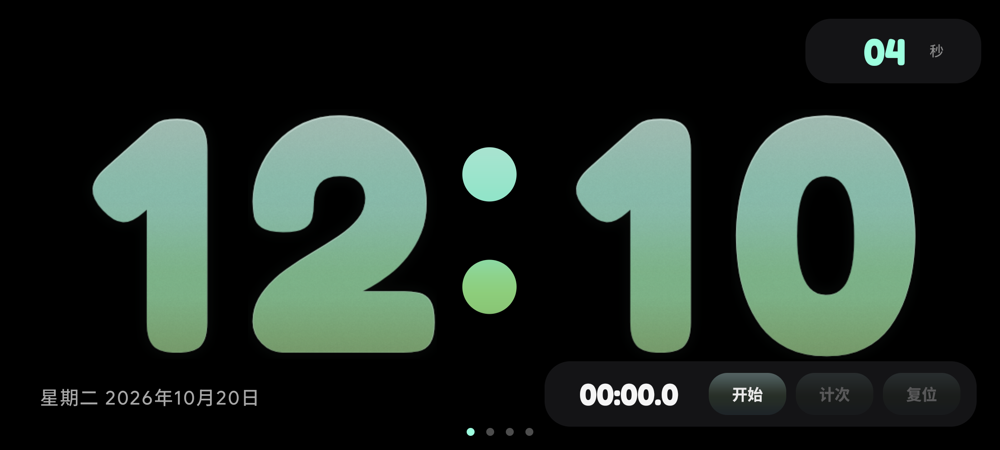
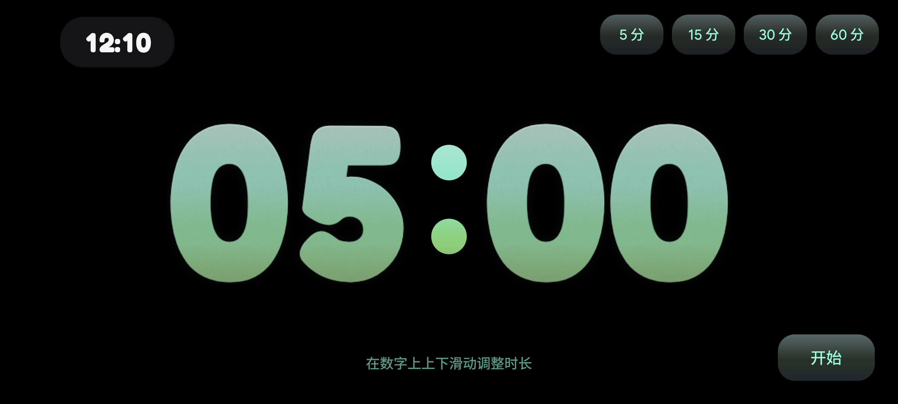
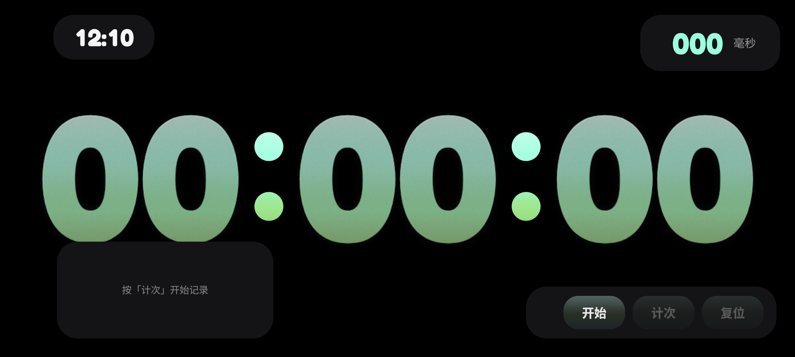
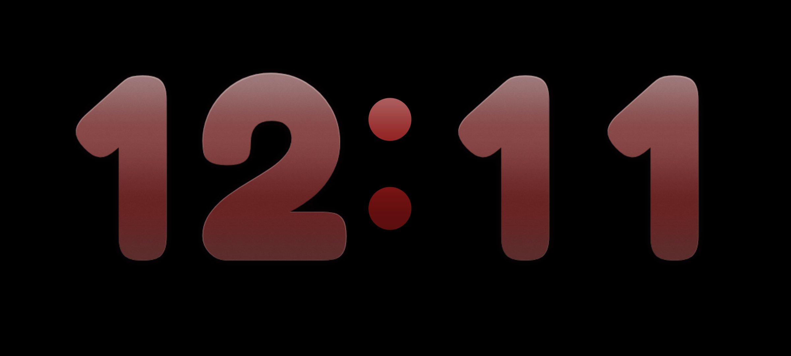

# 静夜时钟 · StandByCat

> 一盏安静、会呼吸的安卓床头钟。全屏常亮、纯黑底、超大字，数字是 iOS 液态玻璃质感。

一个给床头/桌面用的横屏时钟 App：不用解锁、不用点屏幕，瞄一眼就知道几点。
所有数字与控件都是自绘的，没有用任何 UI 框架 ——— 换来的是极低的功耗和完全可控的动画手感。

> **本项目全部由 AI 辅助制作**：需求拆解、Kotlin 代码、液态玻璃渲染配方、真机验证与截图、
> 说明书与宣传片，均在与 AI 的结对协作中完成。

<p align="center">
  
  
</p>
<p align="center">
  
  
</p>

<p align="center">
  ▶ <a href="https://github.com/GHER-man/standbycat/releases/download/v7.3/standbycat-promo.mp4"><b>看 35 秒宣传片</b></a>
  &nbsp;·&nbsp;
  ⬇ <a href="https://github.com/GHER-man/standbycat/releases/latest"><b>下载安装包</b></a>
</p>

## 功能

**四个页面，上下滑动切换**

| 页面 | 内容 |
|---|---|
| ① 倒计时 | 大号「分:秒」，在数字上**上下滑动**设定时长（滚轮手感：上滑增加、下滑减少、松手带惯性），右上角 5/15/30/60 分快捷值，结束响**闹钟式持续震动** |
| ② 数字钟 | 主页面。超大「时:分」+ 右上跳秒 + 右下秒表小面板 + 底部日期与页码点 |
| ③ 计时器 | 时:分:秒 + 毫秒，支持计次（记总时间与每圈时间） |
| ④ 模拟指针 | 放射刻度表盘，中心显示时间与日期 |

**手势**

- 上下滑动：翻页（相邻两页联动、带阻尼）
- 双击：切换夜间模式
- 长按约 0.5 秒：打开设置面板（换色 / 夜间模式 / 简化动效 / 按键震动）
- 点数字：那一位数字单独 Q 弹一下
- 点日期：进入日历页

**质感与动效**

- 数字是**液态玻璃**：外发光、四段平滑体色渐变、底部内阴影、顶部镜面、磨砂噪点、边缘细高光
- 换字时：旧数字向上被拉走并淡出，新数字自下而上淡入，落位压一下，相邻数字会被轻轻撞一下
- 所有按键：液态玻璃底 + 按下收缩 / 松手回弹（easeOutBack 过冲）
- 夜间模式：整屏转暗红、主页面只留时分，按键同步变深红

**其它**

- 防烧屏：大字与部件会隔一段时间轻微换位
- 简化动效开关：关掉玻璃分层、卷动、摇晃与回弹，更省电（低配机友好）
- 记住上次停留的页面；不联网、不上传任何数据

## 构建

环境：JDK 17、Android SDK 34、Gradle 8.9。

```bash
# 1. 准备签名（可选；不提供则自动用 debug 签名）
cp keystore.properties.example keystore.properties
#    然后填入你自己的 keystore 路径与密码

# 2. 构建
export JAVA_HOME=/path/to/jdk17
export ANDROID_HOME=/path/to/android-sdk
export GRADLE_USER_HOME=/path/to/gradle-home   # 可选，避免缓存落到 C 盘
gradle assembleRelease
```

产物在 `app/build/outputs/apk/release/app-release.apk`。

> 仓库里**不包含**签名密钥与密码：`*.keystore`、`keystore.properties` 都在 `.gitignore` 里。
> 没有 `keystore.properties` 时会自动退回 debug 签名，clone 下来直接能跑。

## 目录结构

```
app/src/main/java/com/xiaomi8/standbycat/
  ClockActivity.kt       主界面：四页容器、手势、计时器/倒计时状态机、设置面板
  CalendarActivity.kt    日历页：农历 / 节气 / 节假日 / 倒数日 / 系统日程
  BigClockView.kt        数字钟页（玻璃大字、卷动、摇晃、防烧屏漂移）
  TimerPageView.kt       计时器页（时:分:秒 + 毫秒）
  CountdownPageView.kt   倒计时页（滚轮调时长、闹钟动画）
  ClockView.kt           模拟指针表盘
  Digits.kt              等宽数字排版
  DigitsView.kt          自绘等宽数字控件
  GlassDigits.kt     ★   液态玻璃数字渲染器（分层配方 + 位图缓存）
  GlassUi.kt         ★   按键液态玻璃底 + 按下回弹
  LapListView.kt         计次列表
  SliderView.kt          粗体滑杆
  MsView.kt              毫秒显示
  Haptics.kt             触感反馈（按键两下 / 闹钟式循环震动）
  Lite.kt                简化动效全局开关
  Prefs.kt               本地配置
```

## 几个实现要点

**液态玻璃为什么用位图缓存**
这套质感由 7 层叠加而成（外发光 / 体色渐变 / 内阴影 / 镜面 / 磨砂 / 抖动 / 边缘高光），
每帧现算会掉帧。所以按「字 + 字号 + 配色」把每位数字渲染一次缓存成 Bitmap（0.5 倍分辨率再放大），
之后每帧只 `drawBitmap` ——— UI 线程绘制耗时从 **15.3ms 降到 0.53ms**。
（踩过的坑：缓存 key 忘了写 `equals/hashCode`，等于每帧都新建位图，几分钟就 OOM 闪退。）

**渐变的"分层线"**
渐变本身没问题，是**叠加层的边界**：每层都是"画到某个高度就结束"，结束处斜率突变，人眼就是一道坎。
解决办法是把高光融进同一条曲线（多段 smoothstep 采样、C1 连续），再叠一层 4% 的 RGB 抖动打散 8bit 等值带。

**按键只留一个触摸监听**
一个 View 只能有一个 `OnTouchListener`。之前回弹和触感分别注册，后注册的把前面的顶掉了，
表现就是"只有某个页面的按键有回弹"。现在合并进 `hapticTap()`：按下（震动 + 收缩）、松手（震动 + 回弹）。

## 权限

- `READ_CALENDAR`：日历页读取系统日程（不授权也能正常用时钟）
- `VIBRATE`：按键触感与倒计时提醒
- `WAKE_LOCK` / `SET_WALLPAPER`：保持常亮等相关功能
- 不联网、不收集任何数据

## 演示物料

- `demo/shot-*.png` —— 当前版本（v7.3）的 8 张真机截图，README 用的就是它们
- `demo/mk_doc_html.py` —— 功能说明书（Markdown/纯文本 → HTML）的转换脚本
- `demo/video/` —— 宣传片的合成脚本：`build_promo.py`（暗调 90 秒）、`build_promo_light.py`（亮调 60 秒）、
  `make_bgm.py`（原创配乐）。画面用 Pillow 逐帧渲染，音乐用 numpy 合成，**全部无第三方素材**

成片与 APK 见 **Releases**。

## License

MIT，见 [LICENSE](LICENSE)。
